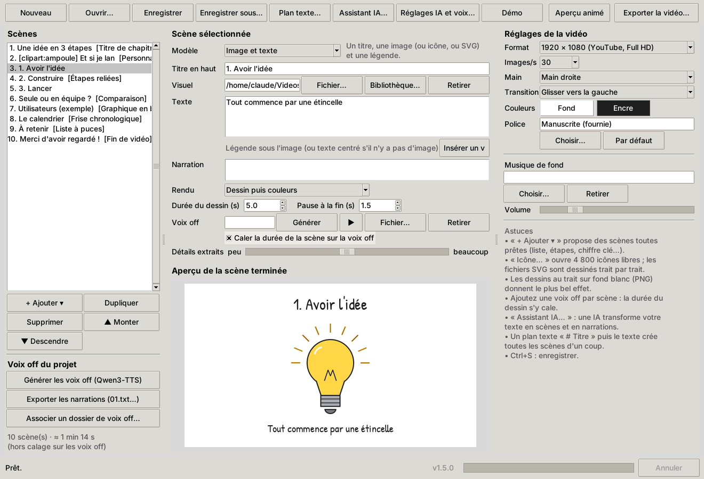
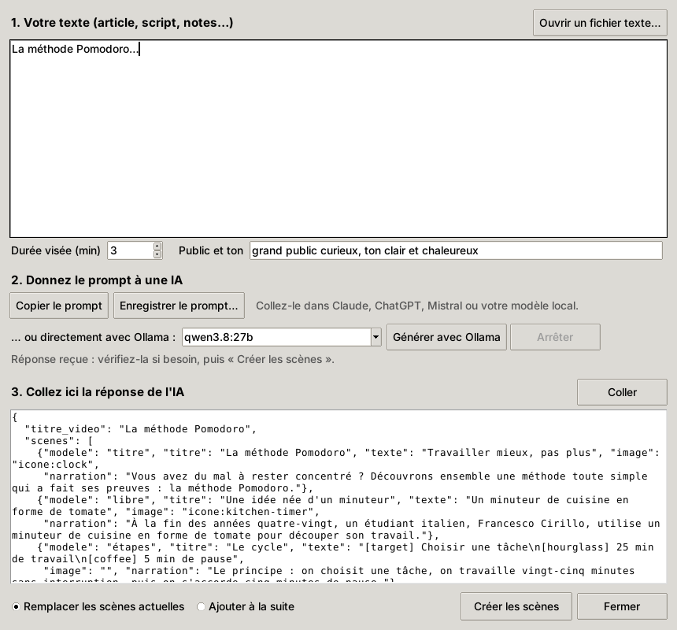
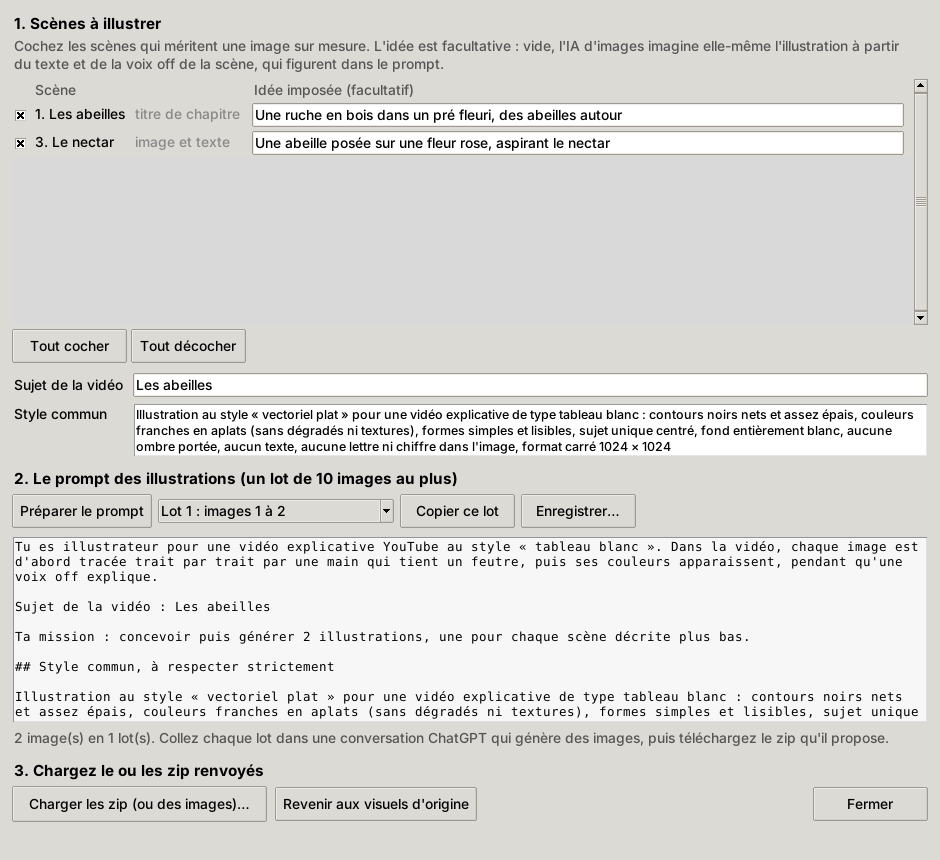
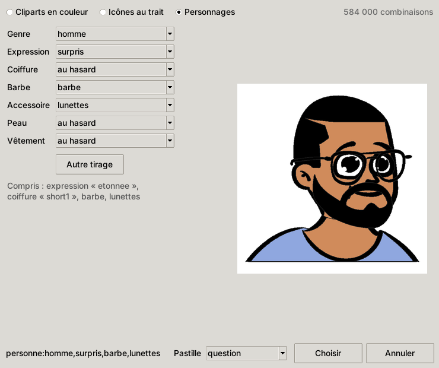
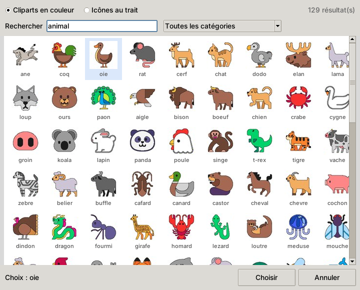

# Whiteboard Studio

Créez des vidéos explicatives « main qui dessine » (*whiteboard animation*) pour YouTube : une main tient un feutre, dessine vos illustrations trait par trait, écrit vos titres à la main, puis les couleurs apparaissent. Voix off et musique de fond comprises, export MP4 prêt à mettre en ligne.


## Fonctionnalités

- **Assistant IA** : collez un texte, l'appli prépare le prompt pour Claude, ChatGPT… ou le fait rédiger directement par un modèle local **Ollama** ; la réponse devient un projet complet (scènes, icônes, narration de chaque scène).
- **Shorts YouTube** : une case dans l'Assistant IA produit une vidéo verticale de moins d'une minute, avec un scénario taillé pour ce format (accroche immédiate, rythme rapide) et des réglages dédiés : rythme « short » sans temps mort, coupes franches, modèle **Accroche** (le texte choc surgit d'un coup puis est surligné), mise en page dans la zone que l'interface de YouTube ne recouvre pas.
- **Sous-titres incrustés** : la narration s'affiche par groupes de mots, au choix en « karaoké » (le mot prononcé passe en couleur) ; un fichier `.srt` est écrit à côté de la vidéo.
- **Bande-son soignée** : musique atténuée sous la voix, niveau normalisé à −14 LUFS (la référence YouTube).
- **Prêt à publier** : miniature en un clic (PNG, 1280 × 720 ou 1080 × 1920) et fiche de publication écrite à côté du MP4 : titres proposés par l'IA, description, chapitres horodatés, hashtags, commentaire à épingler, accroches alternatives à tester.
- **Illustrations sur mesure** (facultatif) : un second prompt, dédié aux images, fait dessiner par ChatGPT des illustrations par lots de 10 ; le zip renvoyé se charge dans l'Assistant et chaque image rejoint sa scène.
- **Voix off Qwen3-TTS intégrée** : les narrations sont lues par votre voix clonée (ou une voix prédéfinie), puis rattachées aux scènes automatiquement.
- **Scènes prédéfinies** : titre de chapitre, liste à puces, étapes reliées par des flèches, comparaison, chiffre clé, citation, fin de vidéo. Il suffit de remplir le texte.
- **Images vectorielles (SVG)** : la main suit exactement chaque tracé du fichier, puis les couleurs (aplats et dégradés simplifiés) apparaissent.
- **Personnages modulaires** ([Open Peeps](https://openpeeps.com), domaine public) : expression, coiffure, barbe, lunettes, peau, vêtement se décrivent en français (« personne:femme,pensive,lunettes »). Un même personnage garde son apparence d'une scène à l'autre, seule son expression change.
- **Compositions** : `clipart:maison+piece`, `clipart:telephone-portable+non`… un visuel plus un autre, ou plus une pastille (ok, non, attention, question, hausse, baisse…).
- **Schémas à partir de vrais chiffres** : graphique en barres, proportion en pictogrammes (« 1 sur 4 »), frise chronologique.
- **Plus de 1 200 cliparts en couleur** (animaux, objets, aliments, lieux, métiers, émotions…) : la main dessine leurs contours, puis les couleurs apparaissent.
- **4 800 icônes au trait** en complément, pour les idées abstraites. Recherche en français dans les deux bibliothèques.
- **Images classiques** : n'importe quelle image (PNG, JPG…) est transformée en tracés, dessinés dans un ordre naturel, puis colorisée si vous le souhaitez.
- **Texte défilant** : dans l'Assistant IA, la case « Texte défilant (sans IA) » transforme un texte de n'importe quelle longueur en scènes qui l'affichent en grand et le font défiler pendant que la voix off le lit (passages d'environ 30 secondes, sans couper les phrases). La même case existe pour chaque scène.
- **Texte écrit à la main** : titres et légendes s'écrivent de gauche à droite avec une police manuscrite (fournie, libre de droits) ou la vôtre.
- **Voix off par scène** : la durée du dessin se cale automatiquement sur la voix. Idéal avec des voix générées par synthèse vocale.
- **Musique de fond** en boucle, volume réglable, avec fondu d'entrée et de sortie.
- **Formats** : 1080p, 720p, 4K, Shorts vertical (1080 × 1920) et carré.
- **Transitions** entre scènes : glisser, fondu ou coupe.
- **Main droite, main gauche ou votre propre main** (PNG détouré).
- **Import d'un plan texte** : tout le script de la vidéo devient des scènes en un clic.
- **Aperçu** fixe instantané et aperçu animé rapide de chaque scène.
- 100 % local : rien n'est envoyé sur Internet.



## Installation (Windows, un clic)

1. Téléchargez le projet (bouton vert **Code → Download ZIP**) et décompressez-le, ou clonez-le.
2. Double-cliquez sur **`install.bat`**.

Le script installe Python 3.12 s'il est absent (via `winget`), crée un environnement isolé `.venv`, installe les dépendances (ffmpeg compris) et place un raccourci **Whiteboard Studio** sur le Bureau et dans le menu Démarrer.

Ensuite, lancez l'application avec le raccourci ou **`lancer.bat`**.

> Pas de droits administrateur nécessaires. Pour désinstaller, supprimez le dossier et les raccourcis.

### macOS / Linux

```bash
python3 -m venv .venv
.venv/bin/pip install -r requirements.txt
.venv/bin/python -m whiteboard
```

Sous Linux, Tkinter s'installe à part si besoin (`sudo apt install python3-tk`).

## Utilisation

1. Cliquez sur **Démo** pour voir un exemple complet, ou partez d'un projet vide.
2. **+ Ajouter ▾** propose les scènes prédéfinies, déjà remplies d'un exemple. Le **Modèle** d'une scène existante peut aussi être changé à tout moment.
3. Pour chaque scène : un titre, un visuel (fichier ou icône), un texte, éventuellement une voix off.
4. **Aperçu animé de la scène** génère un extrait basse définition en quelques secondes.
5. **Exporter la vidéo…** produit le MP4 final.

Le projet s'enregistre en `.json`. Les chemins des images et sons sont stockés relativement au projet : rangez tout dans un même dossier pour le déplacer facilement.

### Du texte à la vidéo avec une IA

1. **Assistant IA…** : collez votre texte (article, script, notes), indiquez la durée visée et le ton.
2. Deux possibilités :
   - **Copier le prompt** et le coller dans une IA externe (Claude, ChatGPT, Mistral…), puis copier toute sa réponse et cliquer sur **Coller**. C'est en général ce qui donne le meilleur découpage ;
   - **Générer avec Ollama** : votre modèle local rédige la réponse directement, en continu dans la fenêtre (rien ne sort de votre ordinateur).
3. **Créer les scènes**.



Cochez **Short (vertical, < 1 min)** pour un Short YouTube : la durée visée passe à 45 secondes, le prompt ajoute des règles propres au format (une accroche dès la première seconde avec le modèle « accroche », une boucle ouverte résolue en fin de vidéo, 5 à 8 scènes, narrations de 8 à 25 mots, peu d'éléments par scène pour l'écran étroit, fin éclair sur une question qui pousse à commenter), et le projet reçoit les réglages Short (ci-dessous). Après création, l'appli affiche la durée estimée et prévient si elle dépasse une minute.

L'IA renvoie aussi un bloc **publication** (titres YouTube, description, hashtags, texte de miniature, commentaire à épingler, variantes d'accroche) conservé dans le projet : voir « Publier ».

### Des Shorts qui retiennent le pouce

Sur téléphone, chaque seconde sans nouveauté à l'écran fait décrocher. Les réglages d'un Short (bouton **Régler pour un Short** dans la fenêtre principale, automatiques depuis l'Assistant IA, ou `python -m whiteboard short projet.json`) :

- **Rythme « short »** (liste *Rythme*) : la main arrive sur le premier trait en 0,1 s, ne sort pas de l'écran entre deux scènes (elle file au trait suivant), les couleurs apparaissent en 0,3 s, le tracé est rapide au début (le visuel se reconnaît tout de suite), la pause finale ne dépasse jamais une seconde et un zoom lent évite l'image figée. Sur un Short de 7 scènes, c'est une quinzaine de secondes de temps mort en moins.
- **Coupes franches** : toute transition est du temps mort sur un écran étroit.
- **Modèle « Accroche (Short) »** : la phrase choc est lisible dès la première image (effet tampon), puis la main passe un coup de surligneur dessous et dessine le visuel. Un titre dessiné lettre à lettre n'est lisible qu'après deux ou trois secondes : trop tard.
- **Zone sûre 9:16** : l'interface de YouTube recouvre le bas de l'écran (titre, chaîne, description) et une colonne à droite (j'aime, commentaires, partage). En vertical, toutes les mises en page se tiennent dans la zone visible, et une bande est réservée aux sous-titres juste au-dessus de l'interface.
- **Fin éclair** : en rythme short, la scène « Fin » sans actions affiche une seule invitation à commenter. Le Short rejoue en boucle : une fin courte relance le début.

### Sous-titres incrustés

Beaucoup de Shorts sont regardés sans le son. Liste **Sous-titres** : *Simple* (le groupe de mots en cours) ou *Karaoké* (groupes de trois mots, le mot prononcé en couleur). Les sous-titres suivent la voix off de la scène : avec une voix générée par Qwen3-TTS, le minutage mot à mot (proportionnel à la longueur des mots, avec une respiration après la ponctuation) colle à la diction. Sans voix off, ils occupent la durée de la scène. À l'export complet, un fichier **`.srt`** est écrit à côté du MP4 (YouTube l'indexe aussi).

### Bande-son

Deux cases à côté du volume de la musique :

- **Musique atténuée sous la voix** (*ducking*) : la musique baisse dès que la voix parle et remonte ensuite. On peut donc la monter à 25-30 % sans gêner.
- **Niveau normalisé (−14 LUFS)** : le niveau auquel YouTube ramène les vidéos ; sans cela, un Short sort souvent plus bas que ses voisins du flux.

La vidéo est encodée en deux temps (images, puis mixage audio sans réencoder) : ces options ne ralentissent pas le rendu.

### Publier

- **Exporter la miniature (PNG)…** : la scène la plus parlante (un chiffre, un personnage, l'accroche…) ou la scène sélectionnée, avec un texte très court sur bandeaux jaunes, en 1280 × 720 (ou 1080 × 1920 pour un Short). Le texte proposé est celui de l'IA (`texte_miniature`).
- **Fiche de publication** : titres, description, hashtags, commentaire à épingler, accroches alternatives. À chaque export complet, la fiche `nom-de-la-video_publication.txt` est écrite à côté du MP4, avec les **chapitres horodatés** (scènes « Titre de chapitre ») à coller dans la description.
- Pour tester plusieurs accroches, `rendu --scenes 1` rend la première scène seule : changez son titre avec une des variantes et comparez.

L'IA découpe le texte en scènes et joue le rôle de **metteur en scène** : le prompt lui apprend à choisir le bon modèle (graphique dès qu'il y a des chiffres comparables, frise pour les dates, personnage pour poser une question ou montrer une émotion…), à composer des visuels et à garder les mêmes personnages d'une scène à l'autre. Elle écrit aussi la **narration** de chaque scène (le texte de la voix off, distinct des mots clés affichés). L'import est tolérant : bloc ```` ```json ````, virgule en trop, modèle mal orthographié ou icône inexistante sont corrigés automatiquement, et la liste des corrections s'affiche. Sans voix off, la durée de chaque scène est estimée d'après la longueur de sa narration.

#### Illustrations sur mesure avec une IA d'images (facultatif)

Les cliparts couvrent l'essentiel, mais une scène précise (« la salle des Taureaux de Lascaux ») gagne parfois à avoir son image. ChatGPT, par exemple, sait générer une série d'images et les rendre dans un zip. Pour cela, l'appli utilise **deux prompts distincts** : le premier écrit le scénario, le second (`whiteboard/assets/prompt_illustrations.md`, modifiable) fait de l'IA d'images l'illustratrice de la vidéo.

Tout se fait depuis l'**Assistant IA**, étape 4, une fois les scènes créées :

1. **Copier le prompt des illustrations** : l'appli prépare un prompt par lot de 10 images au plus, pour les scènes « Image et texte » et « Titre de chapitre ». Pour chaque image, il donne le sujet de la vidéo, le texte à l'écran et la voix off de la scène, un style commun adapté au tableau blanc (traits noirs nets, couleurs en aplats, fond blanc, sans texte) et un nom de fichier imposé (`illus_01.png`…). S'il y a plusieurs lots, choisissez le suivant dans la liste.
2. Collez-le dans ChatGPT, qui conçoit et génère les images puis propose un zip.
3. **Charger les zip** (plusieurs à la fois si besoin) : les images sont rangées dans `nom-du-projet_illustrations/` et rattachées à leur scène, même si vous avez réordonné les scènes entre-temps. Une image au nom imprévu est rattachée dans l'ordre et signalée ; des images isolées sont aussi acceptées.

**Choisir les scènes…** (ou **Prompt des illustrations** dans la fenêtre principale) ouvre la version détaillée : cocher d'autres scènes (listes, chiffres clés), imposer une idée d'image pour une scène, modifier le sujet ou le style, voir le prompt avant de le copier, et **Revenir aux visuels d'origine**.



#### Voix off avec Qwen3-TTS

Whiteboard Studio pilote [Qwen3-TTS](https://github.com/QwenLM/Qwen3-TTS) installé dans **son propre environnement Python** (PyTorch, CUDA…) : rien de lourd n'est ajouté à l'application.

1. **Réglages IA et voix… → Qwen3-TTS** : indiquez le `python.exe` de cet environnement (par exemple `D:\ai\qwen3-tts\qwen_env\Scripts\python.exe`), puis **Vérifier**.
2. Choisissez le modèle. Avec un modèle **Base** (clonage), donnez un extrait de 10 à 20 secondes de la voix à cloner et, idéalement, sa transcription exacte. Avec un modèle **CustomVoice**, choisissez un locuteur prédéfini.
3. **Essayer la voix**, puis dans la fenêtre principale **Générer les voix off (Qwen3-TTS)** pour tout le projet, ou **Générer** pour la scène sélectionnée (▶ pour écouter).

Les fichiers sont rangés dans `nom-du-projet_voix/01.wav`, `02.wav`… et rattachés aux scènes ; la durée du dessin suit alors la voix.

Pour aller vite :
- **plusieurs phrases à la fois** : la carte graphique génère les narrations par lots (4 par défaut, réglable), en regroupant les phrases de longueur voisine ; si la mémoire vidéo manque, les lots se réduisent tout seuls ;
- **modèle gardé chargé** : Qwen3-TTS reste ouvert entre deux générations (5 minutes par défaut, réglable ; **Libérer maintenant** le ferme), donc regénérer une scène est quasi immédiat ;
- **seules les voix à refaire** : chaque voix garde une empreinte de sa narration et des réglages de voix ; **Générer les voix off** ne traite que les scènes nouvelles ou modifiées. Le bouton **Générer** d'une scène la refait toujours ;
- la barre d'état indique la vitesse obtenue (« ×12 le temps réel ») ;
- le modèle 0.6B est environ deux fois plus rapide que le 1.7B, pour une voix un peu moins naturelle. Avec l'option **Libérer la mémoire vidéo** (Ollama), le modèle de rédaction est déchargé dès sa réponse reçue, pour laisser la carte graphique à la synthèse vocale.

#### Ollama

**Réglages IA et voix… → Ollama** : adresse (par défaut `http://localhost:11434`), modèle, taille de contexte (32 768 conseillé), température. L'option **Sans phase de réflexion** envoie `/no_think` : plus rapide, et souvent meilleur en rédaction avec les modèles Qwen3. La réponse est demandée au format JSON.

#### Autre outil de synthèse vocale

1. **Exporter les narrations** écrit `01.txt`, `02.txt`… (une par scène) et `script_complet.txt`.
2. Générez les voix avec votre outil de synthèse vocale (ou enregistrez-vous) en gardant les numéros : `01.wav`, `02.wav`…
3. **Associer un dossier de voix off** rattache chaque fichier à sa scène (le premier nombre du nom de fichier donne le numéro de scène) ; la durée du dessin se cale alors sur la voix.

Le prompt est modifiable : `whiteboard/assets/prompt_video.md`.

### Scènes prédéfinies

| Modèle | Titre | Texte |
|---|---|---|
| Image et texte | titre en haut | légende sous le visuel |
| Titre de chapitre | grand titre souligné | sous-titre |
| Accroche (Short) | la phrase choc, affichée d'un coup puis surlignée | précision courte (facultatif) |
| Liste à puces | titre de la liste | un point par ligne (coche, ou icône) |
| Étapes reliées | titre du processus | une étape par ligne, reliées par des flèches |
| Comparaison | titre | une colonne par ligne (2 ou 3), « VS » entre deux colonnes |
| Chiffre clé | le chiffre, entouré | sa légende |
| Citation | l'auteur | la citation |
| Graphique en barres | titre | une barre par ligne : `Libellé : valeur` |
| Proportion | « 1 sur 4 » ou « 25 % » | ce qu'elle représente |
| Frise chronologique | titre | une date par ligne : `[visuel] Date : événement` |
| Personnage qui parle | titre (facultatif) | contenu de la bulle (texte, ou `[visuel]` puis texte) ; le visuel est le personnage |
| Fin de vidéo | message de fin | actions (par défaut : Abonnez-vous, J'aime, Commentez, en cliparts) |

Dans le texte des modèles, un visuel peut précéder chaque ligne entre crochets :

```text
[clipart:ampoule] L'idée
[tools] La fabrication
[C:/Mes images/fusee.svg] Le lancement
```

Le bouton **Insérer un visuel…** écrit ce code pour vous sur la ligne du curseur. Toutes les mises en page s'adaptent au format vertical (Shorts).

### Personnages



Onglet **Personnages** de la bibliothèque : choisissez genre, expression, coiffure, barbe, accessoire, peau et couleur du haut, ou tapez directement `personne:` suivi de mots-clés français, dans n'importe quel ordre :

```text
personne:femme,pensive,lunettes
personne:homme,inquiet,barbe,bleu
personne:âgé,explique,cheveux blancs
```

Expressions comprises : content, heureux, rieur, calme, pensif, explique, concentré, surpris, inquiet, triste, effrayé, en colère, fatigué, méfiant, amoureux, débordé, malicieux. Ce qui n'est pas précisé est tiré au sort, toujours de la même façon : `personne:femme,lunettes,bleu,triste` puis `personne:femme,lunettes,bleu,heureuse` montrent la même personne. Dans le modèle **Personnage qui parle**, un personnage « pensif » a une bulle de pensée.

### Compositions et pastilles

Un `+` ajoute un second élément dans un coin du premier : un autre visuel en petit (`clipart:ordinateur-portable+cadenas-ferme`), ou une pastille : `ok`, `non`, `attention`, `question`, `plus`, `moins`, `etoile`, `coeur`, `hausse`, `baisse`. La liste **Pastille** de la bibliothèque l'ajoute pour vous. Les compositions marchent partout : champ « Visuel », lignes des modèles, personnages (`personne:homme,inquiet+question`).

### Cliparts, icônes et images vectorielles



**Bibliothèque…**, à côté du champ « Visuel », ouvre deux collections :

- **Cliparts en couleur** : plus de 1 200 illustrations [Fluent Emoji](https://github.com/microsoft/fluentui-emoji) de Microsoft (style « Flat », licence MIT), nommées et classées en français. La main en trace les contours (les traits cachés par une forme posée par-dessus ne sont pas dessinés), puis les couleurs apparaissent. En mode « Dessin au trait seulement », elles restent en croquis.
- **Icônes au trait** : 4 800 icônes [Tabler](https://tabler.io/icons) (licence MIT, sans les logos de marques), idéales pour les idées abstraites. La recherche comprend les mots français courants : « fusée », « argent », « équipe »…

Dans le texte des modèles, un clipart s'écrit `[clipart:abeille] Libellé` et une icône `[bulb] Libellé` ; **Insérer un visuel…** écrit ce code pour vous.
- Un fichier **SVG** (Inkscape, Illustrator, Figma, banques d'images vectorielles…) est dessiné trait par trait, dans l'ordre du fichier, puis colorisé. Les textes intégrés au SVG et les images bitmap qu'il contient sont ignorés ; un dégradé est remplacé par sa couleur médiane.

### Conseils pour un beau rendu

- Les **dessins au trait sur fond blanc ou transparent** donnent le meilleur effet. Les photos fonctionnent aussi, mais le croquis est plus approximatif.
- Le curseur **Détails extraits** règle la quantité de traits tirés d'une image : baissez-le si le dessin est trop chargé.
- **Dessin au trait seulement** garde l'aspect croquis ; **Dessin puis couleurs** fait apparaître l'image originale à la fin.

### Importer un plan texte

Écrivez le script dans un fichier `.txt` :

```text
# Pourquoi le ciel est bleu
La lumière du Soleil contient toutes les couleurs.

# La diffusion
L'air disperse davantage le bleu que le rouge.
```

Chaque ligne commençant par `#` crée une scène (le titre) ; les lignes suivantes deviennent son texte. Sans aucun `#`, chaque paragraphe devient une scène. Il ne reste qu'à ajouter images et voix off.

### Voix off

Ajoutez un fichier audio (WAV, MP3, M4A…) par scène. Avec **Caler la durée de la scène sur la voix off** coché, le dessin occupe le temps de la phrase et la scène suivante démarre juste après. Une habitude efficace : un fichier audio par paragraphe du script, nommés `01.wav`, `02.wav`…

### Votre propre main

Choisissez **Main → Image personnalisée…** et fournissez un PNG transparent d'une main qui tient un stylo, la pointe du stylo dirigée vers le bas à gauche (elle est détectée automatiquement). Le bras doit sortir par le bas ou le côté droit de l'image.

## Ligne de commande

Utile pour automatiser la production :

```bash
# Fabriquer la vidéo d'un projet
.venv\Scripts\python -m whiteboard rendu mon-projet.json -o ma-video.mp4

# Aperçu rapide (demi-résolution), scènes 2 et 3 seulement
.venv\Scripts\python -m whiteboard rendu mon-projet.json --apercu --scenes 2,3

# Créer un projet à partir d'un plan texte
.venv\Scripts\python -m whiteboard plan script.txt -o mon-projet.json

# Assistant IA en ligne de commande
.venv\Scripts\python -m whiteboard prompt article.txt --duree 3 -o prompt.txt
.venv\Scripts\python -m whiteboard prompt article.txt --short -o prompt_short.txt   # Short vertical
.venv\Scripts\python -m whiteboard ia reponse_ia.txt -o mon-projet.json
.venv\Scripts\python -m whiteboard narrations mon-projet.json voix
.venv\Scripts\python -m whiteboard voix mon-projet.json voix

# Illustrations : prompts pour ChatGPT, puis chargement des zip
.venv\Scripts\python -m whiteboard illustrations mon-projet.json -o prompts.txt
.venv\Scripts\python -m whiteboard images mon-projet.json illustrations_lot_1.zip illustrations_lot_2.zip

# Ollama et Qwen3-TTS (réglages de l'interface)
.venv\Scripts\python -m whiteboard ollama article.txt --duree 3 -o mon-projet.json
.venv\Scripts\python -m whiteboard tts mon-projet.json            # seulement les voix nouvelles ou modifiées
.venv\Scripts\python -m whiteboard tts mon-projet.json --toutes   # toutes

# Shorts et publication
.venv\Scripts\python -m whiteboard short mon-projet.json                 # copie du projet en Short (vertical, rythme, coupes, karaoké)
.venv\Scripts\python -m whiteboard rendu mon-projet.json --miniature     # vidéo + .srt + fiche de publication + miniature
.venv\Scripts\python -m whiteboard miniature mon-projet.json --texte "3 erreurs" --scene 2
.venv\Scripts\python -m whiteboard publication mon-projet.json

# Créer le projet de démonstration
.venv\Scripts\python -m whiteboard demo dossier-demo
```

Le format du projet JSON est simple à générer depuis un autre programme (`modele` : `libre`, `titre`, `accroche`, `liste`, `etapes`, `comparaison`, `chiffre`, `citation`, `graphique`, `proportion`, `chronologie`, `personnage`, `fin` ; `image` accepte aussi `clipart:nom` et `icone:nom` ; `rythme` : `normal` ou `short` ; `sous_titres` : `""`, `simple` ou `karaoke`) :

```json
{
  "largeur": 1920, "hauteur": 1080, "fps": 30,
  "main": "droite", "transition": "glisser",
  "musique": "musique.mp3", "volume_musique": 0.12,
  "rythme": "normal", "sous_titres": "karaoke",
  "ducking": true, "normaliser": true,
  "publication": {"titres_youtube": ["…"], "description": "…", "hashtags": ["#…"],
                  "texte_miniature": "…", "commentaire_epingle": "…"},
  "scenes": [
    {"modele": "libre", "titre": "Introduction", "image": "images/ampoule.png", "texte": "Une idée",
     "mode": "couleur", "duree_dessin": 6, "pause": 2,
     "narration": "Texte lu par la voix off.",
     "audio": "voix/01.wav", "caler_sur_audio": true, "sensibilite": 50},
    {"modele": "etapes", "titre": "Le processus", "texte": "[bulb] Idée\n[rocket] Lancement",
     "image": "", "audio": "voix/02.wav"}
  ]
}
```

## Publier sur GitHub

Double-cliquez sur **`publier_github.bat`**. La première fois, il installe Git et GitHub CLI si nécessaire, vous connecte à votre compte GitHub (dans le navigateur), puis crée le dépôt (public ou privé, au choix) et l'envoie. Les fois suivantes, il envoie simplement vos modifications avec un message de version.

Les vidéos (`*.mp4`) et l'environnement `.venv` sont exclus du dépôt. Les tests automatiques s'exécutent sur GitHub à chaque envoi (Windows et Linux).

## Comment ça marche

1. Une image classique est convertie en croquis (seuillage adaptatif OpenCV) ; un SVG ou une icône est lu tracé par tracé.
2. Le croquis est découpé en petites cellules ; un parcours qui suit les traits, bloc après bloc en allant au plus proche, donne l'ordre de dessin. Le texte, lui, est parcouru de gauche à droite.
3. Pour un dessin vectoriel, la pointe du feutre suit directement les chemins du fichier.
4. Chaque image de la vidéo révèle les traits suivants et place la pointe du feutre sur le dernier.
5. Les images sont envoyées directement à ffmpeg (H.264) ; les sous-titres sont incrustés au passage.
6. Un second passage ffmpeg, sans réencoder la vidéo, mixe voix off, musique (atténuée sous la voix), et normalise le niveau.

## Développement

```bash
.venv\Scripts\pip install pytest
.venv\Scripts\python -m pytest
```

| Fichier | Rôle |
|---|---|
| `whiteboard/traits.py` | extraction de l'encre et ordre de tracé |
| `whiteboard/vecteur.py` | lecture des SVG, bibliothèque d'icônes, parcours vectoriel |
| `whiteboard/modeles.py` | scènes prédéfinies et traits à main levée |
| `whiteboard/illustrations.py` | prompts d'images par lots, chargement des zip |
| `whiteboard/ia.py` | prompt, import de la réponse d'IA, narrations et voix off |
| `whiteboard/ollama.py` | client Ollama (flux continu, JSON, sans réflexion) |
| `whiteboard/tts.py`, `tts_worker.py` | pilotage de Qwen3-TTS dans son propre environnement |
| `whiteboard/config.py` | réglages enregistrés (`%APPDATA%\WhiteboardStudio\config.json`) |
| `whiteboard/rendu.py` | mise en page (zone sûre 9:16), rythmes, animation, export |
| `whiteboard/sous_titres.py` | découpage minuté de la narration, incrustation, fichier .srt |
| `whiteboard/publication.py` | miniature, fiche de publication, chapitres |
| `whiteboard/main.py` | la main dessinée (générée par le programme) |
| `whiteboard/video.py` | ffmpeg : encodage, puis mixage audio (ducking, loudnorm) |
| `whiteboard/gui.py` | interface Tkinter |
| `whiteboard/projet.py` | format des projets |

## Licence

Code sous licence MIT. Police *Patrick Hand* de Patrick Wagesreiter, sous licence SIL Open Font License 1.1. Icônes [Tabler Icons](https://tabler.io/icons) de Paweł Kuna, sous licence MIT (`whiteboard/assets/icones/LICENSE-Tabler.txt`). Personnages [Open Peeps](https://openpeeps.com) de Pablo Stanley, dans le domaine public (CC0), via [DiceBear](https://github.com/dicebear/dicebear) (`outils/construire_personnages.mjs`). Cliparts [Fluent Emoji](https://github.com/microsoft/fluentui-emoji) de Microsoft, sous licence MIT, avec les noms français des annotations Unicode CLDR via [emojibase](https://emojibase.dev) (licence MIT) : voir `whiteboard/assets/cliparts/`. La bibliothèque se reconstruit avec `outils/construire_cliparts.py`. Toutes les illustrations de démonstration et la main sont dessinées par le programme.
